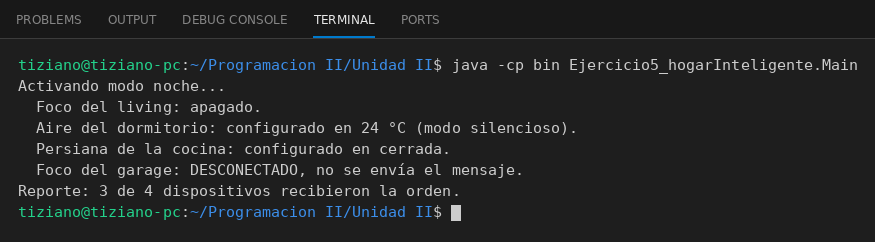

# HubCentral

Programación II - Unidad 2 - Ejercicio 5

## Consigna
Un HubCentral envía órdenes a distintos dispositivos del hogar (modo noche) verificando que estén conectados.

## Lógica
- `DispositivoInteligente` (clase base): `encender()`, `apagar()`, `configurar(parametro)` y `aplicarModoNoche()`.
- `FocoInteligente`, `AireAcondicionado` y `Persiana` sobrescriben `aplicarModoNoche()` (apagar, fijar 24 °C, cerrar).
- `HubCentral.activarModoNoche()`: recorre la colección; si un dispositivo está desconectado no le envía el mensaje, si no le manda la orden (polimorfismo), y al final imprime un reporte.
- `Main`: hub con cuatro dispositivos, uno de ellos desconectado.

## Ejecución

